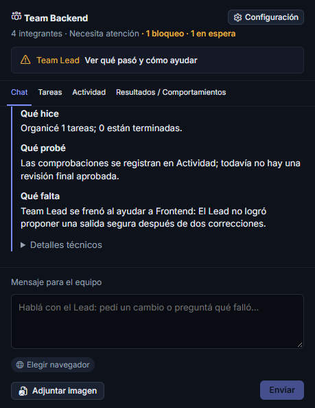
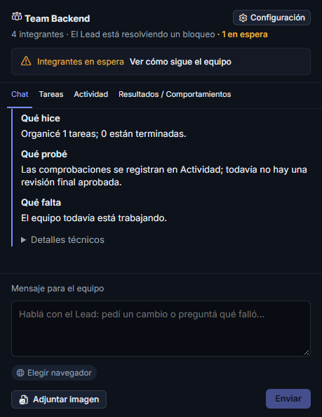

# Bloqueos del equipo y consultas al Lead

Una respuesta `resume` puede incluir instrucciones para la propia tarea solicitante dentro de `resumeTasks`: se conservan y se normalizan a la continuación normal, sin crear otro intento ni repetir acciones. Las instrucciones idénticas repetidas para esa tarea se guardan una sola vez. Los errores de IDs, instrucciones vacías o intentos de reanudar otra tarea activa vuelven al Lead para corregir su decisión; no se aplican parcialmente ni se convierten directamente en pedidos al usuario.

Si el chat del Lead responde sin el formato esperado, hay hasta dos turnos automáticos para reformatear esa respuesta en la misma sesión. Esos turnos deshabilitan todas las herramientas, incluidas las de navegador y escritorio: corrigen la presentación sin repetir las acciones del pedido original.

La instalación de Windows comprueba el espacio disponible antes de reemplazar archivos y verifica después que el ejecutable OpenCode tenga todas sus secciones PE y pueda informar su versión. La app también detecta un ejecutable truncado antes de iniciarlo y explica cómo reparar la instalación, en lugar de mostrar el error de Windows 193 como un fallo de cuenta. El actualizador conserva el repositorio y la clave oficiales.

El encabezado muestra quién necesita ayuda y ofrece «Ver qué pasó y cómo ayudar». Cada tarjeta resume en tres líneas: «Tenía» (hasta dos tareas propias y cuántas más), «Me frena» (tarea y causa) y «Para seguir» (ayuda concreta). No atribuye al Lead las tareas de otros integrantes. La explicación completa queda plegada en «Ver detalles»; «Ampliar diagnóstico» abre una vista más ancha, útil cuando el panel de chat es angosto. Las esperas dependientes quedan plegadas detrás del problema principal. El campo de mensaje mantiene una altura mínima, y leer un diagnóstico no fuerza el desplazamiento al último mensaje.

La compilación local combina la base oficial 0.14.11 con estos cambios. Si el instalador incluye `plugins.guillecodeBuild.revision` en su configuración de compilación, «Actualizaciones» muestra esa revisión aparte de la versión oficial. El aviso de estar al día se refiere expresamente a las publicaciones oficiales. El repositorio y la clave de firma del actualizador siguen siendo los originales.

`app.exe --build-info` devuelve la versión y la revisión de esa misma configuración embebida, sin abrir ventanas, iniciar el motor ni modificar el perfil. Permite comprobar la identidad del ejecutable instalado además de comparar su hash con el artefacto compilado.

Un fallo al revisar un pedido de coordinación se atribuye al Lead y abre su sesión de coordinación, mientras el especialista figura esperando sus instrucciones. Cuotas y problemas de cuenta indican revisar el acceso o cambiar el modelo; no prometen que reintentar restablece el saldo. Los permisos y preguntas identifican al agente y llevan a su sesión. Las tareas independientes pueden continuar.

Mientras el Lead responde, se pueden enviar consultas de estado como «qué falló», «quién está bloqueado» o «cómo va». Se contestan desde el registro guardado, sin inferencia adicional, sin cancelar la sesión pendiente ni iniciar otro trabajo. Las instrucciones nuevas conservan la exclusión de mensajes en curso para no duplicar acciones. Los errores técnicos antiguos del chat se convierten a texto humano y no exponen cabeceras del proveedor.

Un fallo técnico de coordinación sin una necesidad real de cuenta, permiso o una decisión imprescindible se devuelve al Lead para corregir su respuesta; no se convierte directamente en una solicitud al usuario. Las decisiones de alcance incluyen `userRequest: {kind: "decision", question: "pregunta concreta"}`. Cada problema técnico tiene hasta tres intervenciones de recuperación, con un máximo total de nueve por tarea: resolver un problema y encontrar otro diferente no consume automáticamente el mismo límite. Se mantienen las comprobaciones, las sesiones y los controles de acceso.

Si el cierre no aprueba la entrega y tampoco asigna tareas para lo pendiente, el Lead debe corregir ese cierre y delegar las comprobaciones o correcciones técnicas. El QA manual del usuario se pide después de la entrega comprobada. La prueba nativa de ayuda incluye un especialista bloqueado, una escalada técnica indebida al usuario, una prueba declarada sin evidencia y un cierre prematuro; el equipo los resuelve conservando la misma sesión y sin repetir escrituras ni comandos.

Antes de comenzar, el Lead reúne las preguntas imprescindibles sobre el resultado en un solo mensaje. No pregunta cuántos agentes contratar ni pide confirmar decisiones técnicas rutinarias. Si devuelve `questions` no vacías, la app guarda las preguntas como conversación y no crea una ejecución, incluso si el modelo también devuelve `action: "work"`. La referencia al pedido original queda persistida: al contestar, el plan recibe las palabras originales del usuario, las preguntas y sus respuestas; no solo la última contestación. No se arrastran aclaraciones de una ejecución anterior a un pedido independiente. Un pedido claro comienza directamente, sin una confirmación adicional.

Durante la ejecución los especialistas piden ayuda al Lead y el equipo sigue hasta implementar y comprobar la entrega. Las instrucciones de planificación y coordinación reservan las consultas intermedias para un permiso/acceso real o una decisión imprescindible imprevista sin alternativa segura, explicando por qué no se pudo prever al principio. Esto no elimina los permisos del motor ni garantiza que un proveedor externo esté disponible. El usuario revisa al final y puede aprobar con «trabajo completado» o pedir mejoras.

Si falla la coordinación del propio Lead, el scheduler confirma primero la detención de esa sesión de lectura y vuelve a poner el pedido en revisión automática. El Lead recibe la causa y debe cambiar de estrategia: aislar el paso mínimo, revisar el contrato o delegar una tarea de ayuda. El especialista conserva su sesión, archivos, criterios e intentos; no vuelve a ejecutar sus efectos por este fallo. El encabezado indica que el Lead está buscando otra salida, sin pedir «Reconciliar y reintentar» durante esa recuperación. Hay hasta dos recuperaciones de coordinación por pedido, además de las correcciones locales de respuesta y con el límite total de sesiones existente; el presupuesto se conserva al reiniciar. Una sesión cuya detención no pudo confirmarse, un permiso o acceso real y una decisión externa explícita no se reanudan a ciegas.

La prueba nativa fuerza tres respuestas inválidas seguidas del Lead, agota las correcciones locales y verifica la recuperación automática, la continuación del mismo trabajador y la finalización del Frontend independiente. La prueba de interfaz reproduce el fallo registrado y su paso a recuperación sin acciones del usuario. Estas capturas corresponden a datos controlados de esa prueba:

Si el motor deja una respuesta intermedia inactiva durante 90 segundos sin resultado final, se informa el problema conservando la sesión y sus efectos. Estar ejecutando una herramienta o esperando un permiso restablece ese reloj: no se deduce un bloqueo por el solo paso del tiempo mientras el motor declara trabajo activo. El cierre sigue requiriendo todas las comprobaciones y el QA manual del usuario después de la entrega técnica.

La validación incluye pruebas de atribución del bloqueo y recomendaciones, consultas locales durante un mensaje pendiente, disposición del panel a 1000 × 650, diagnóstico ampliado, recuperación de la misma sesión y conservación de los efectos tras reiniciar. Las pruebas nativas usan OpenCode y Tauri reales con inferencia determinista local; no prueban disponibilidad de cuentas de producción.

Capturas reales de la interfaz con datos de prueba controlados: Lead detenido por límite de cuenta y especialista esperando instrucciones. No corresponden a una sesión privada ni acreditan disponibilidad de un proveedor de producción.
