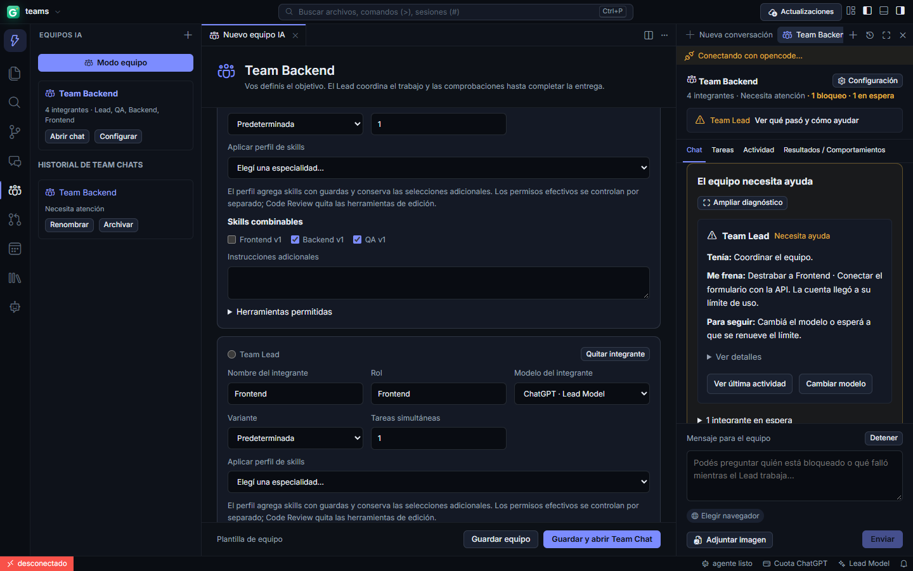
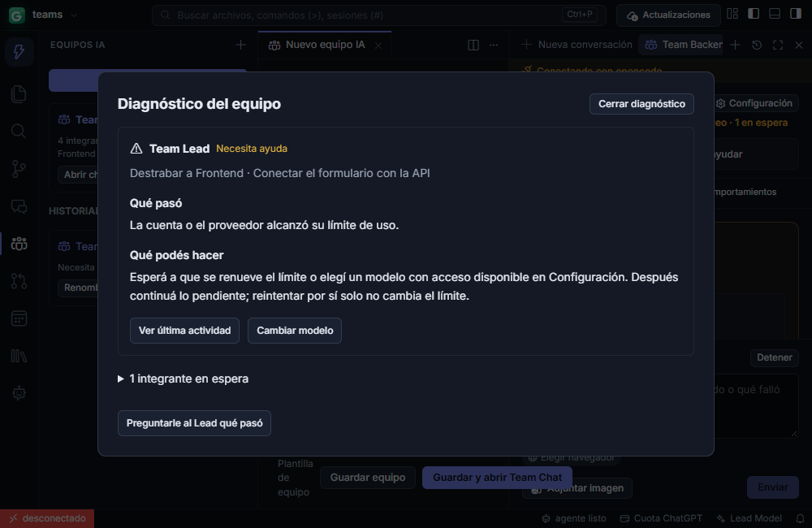

# Bloqueos del equipo y consultas al Lead

El encabezado muestra quién necesita ayuda y ofrece «Ver qué pasó y cómo ayudar». Cada tarjeta resume en tres líneas: «Tenía» (hasta dos tareas propias y cuántas más), «Me frena» (tarea y causa) y «Para seguir» (ayuda concreta). No atribuye al Lead las tareas de otros integrantes. La explicación completa queda plegada en «Ver detalles»; «Ampliar diagnóstico» abre una vista más ancha, útil cuando el panel de chat es angosto. Las esperas dependientes quedan plegadas detrás del problema principal. El campo de mensaje mantiene una altura mínima, y leer un diagnóstico no fuerza el desplazamiento al último mensaje.

La compilación local combina la base oficial 0.14.11 con estos cambios. Si el instalador incluye `plugins.guillecodeBuild.revision` en su configuración de compilación, «Actualizaciones» muestra esa revisión aparte de la versión oficial. El aviso de estar al día se refiere expresamente a las publicaciones oficiales. El repositorio y la clave de firma del actualizador siguen siendo los originales.

Un fallo al revisar un pedido de coordinación se atribuye al Lead y abre su sesión de coordinación, mientras el especialista figura esperando sus instrucciones. Cuotas y problemas de cuenta indican revisar el acceso o cambiar el modelo; no prometen que reintentar restablece el saldo. Los permisos y preguntas identifican al agente y llevan a su sesión. Las tareas independientes pueden continuar.

Mientras el Lead responde, se pueden enviar consultas de estado como «qué falló», «quién está bloqueado» o «cómo va». Se contestan desde el registro guardado, sin inferencia adicional, sin cancelar la sesión pendiente ni iniciar otro trabajo. Las instrucciones nuevas conservan la exclusión de mensajes en curso para no duplicar acciones. Los errores técnicos antiguos del chat se convierten a texto humano y no exponen cabeceras del proveedor.

Si el motor deja una respuesta intermedia inactiva durante 90 segundos sin resultado final, se informa el problema conservando la sesión y sus efectos. Estar ejecutando una herramienta o esperando un permiso restablece ese reloj: no se deduce un bloqueo por el solo paso del tiempo mientras el motor declara trabajo activo. El cierre sigue requiriendo todas las comprobaciones y el QA manual del usuario después de la entrega técnica.

La validación incluye pruebas de atribución del bloqueo y recomendaciones, consultas locales durante un mensaje pendiente, disposición del panel a 1000 × 650, diagnóstico ampliado, recuperación de la misma sesión y conservación de los efectos tras reiniciar. Las pruebas nativas usan OpenCode y Tauri reales con inferencia determinista local; no prueban disponibilidad de cuentas de producción.

Capturas reales de la interfaz con datos de prueba controlados: Lead detenido por límite de cuenta y especialista esperando instrucciones. No corresponden a una sesión privada ni acreditan disponibilidad de un proveedor de producción.
